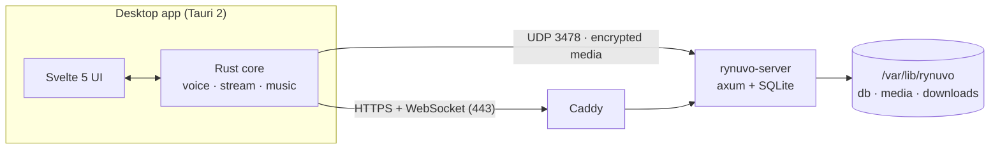

<div align="center">


# Rynuvo

**A small, private place for one circle of friends to talk, play, watch and listen together.**

Voice, screen share, chat and shared music, self-hosted on one tiny VPS.
No accounts, no paywalls, no loading spinners.


</div>

---

## Why it exists

Four friends, mostly gaming together with the mic open, sometimes watching a film through one
person's screen. Discord did the job, with a few complaints: screen share locked at 720p30
without paying, an app that sometimes hangs on loading, and a client that feels heavy next to a
game.

Rynuvo is the answer for that one circle. It is not trying to be a platform:

- **Light.** The server idles under 50 MB of RAM with four people in voice. The app is ready in
  about two seconds.
- **No paywall.** Screen share goes to 1080p60 and beyond when the network allows, with the
  shared app's sound.
- **Ours.** Everything lives on our own VPS in a single SQLite file.

## What's inside

### 🎙️ Voice rooms
- Open mic with voice activity, mute, deafen and per-person volume (up to 200%).
- Clean audio: echo cancellation, noise suppression, auto gain and RNNoise, all in a native Rust
  engine, encoded with Opus.
- Global mute and deafen shortcuts that work while a game is fullscreen.
- The room shows friends as seats round a lamp that glows when someone talks, not as a video grid.
- Small, calm sounds for joining, leaving, mute, deafen and a friend going live.
- Falls back to encrypted WebSocket frames over HTTPS when UDP is blocked.

### 🖥️ Screen share
- A full screen or a single window, with **only that app's audio**.
- Hardware encoding: VideoToolbox on Mac; H.264, HEVC or AV1 on the GPU on Windows.
- Capture through ScreenCaptureKit (macOS) and Windows Graphics Capture with WASAPI loopback.

### 💬 Chat
- Text channels with light markdown, edit and delete.
- Paste or drop images. They are shrunk to WebP on your machine before upload.
- Desktop notifications for mentions and new messages.

### 🎵 Music together
- Search YouTube Music from inside a room and build a shared queue.
- Everyone hears the same song at the same moment. It plays through the voice engine, so it ducks
  under people talking.
- Synced lyrics (LRCLIB and NetEase) with optional translation.
- Music videos play in the panel, in step with the room. The panel folds into a mini player in the
  room header.
- Skip votes, so the queue stays fair.

### 🔐 Access without accounts
- Join with **server address + invite code + nickname**. A random device token is kept in the OS
  keychain and you are signed in from then on.
- Whoever creates a channel owns it. One super-admin manages invites and members.
- Move to a new device with a one-time transfer code.
- Installers for macOS and Windows that update themselves from the server.

## How it fits together



Media does not use the webview's WebRTC. Audio and video are captured, processed, encoded and sent
by native Rust code inside the Tauri process. The server relays media between friends and keeps
the chat, the channels and the shared music state.

## Repository layout

| Path | What lives there |
|---|---|
| `apps/desktop/` | The desktop app: Svelte 5 UI in `src/`, Rust core in `src-tauri/` |
| `apps/desktop/src-tauri/src/voice/` | Audio engine: devices, DSP, jitter buffer, mixer, sounds |
| `apps/desktop/src-tauri/src/stream/` | Screen capture and hardware encoding |
| `apps/desktop/src-tauri/src/music/` | YouTube Music, lyrics and translation |
| `crates/rynuvo-server/` | The server: HTTP API, WebSocket hub, voice relay, STUN |
| `crates/rynuvo-proto/` | Messages shared by the app and the server |
| `deploy/` | VPS install, Caddy site, systemd unit, release publishing |
| `scripts/` | Local build helpers |

## Running it locally

You need Rust (2024 edition), Node with pnpm, and the Tauri 2 prerequisites for your OS.

**1. Start a server**

```bash
cargo run -p rynuvo-server -- serve --config deploy/config.dev.toml
```

**2. Get an owner code** (the first person to join with it becomes super-admin)

```bash
cargo run -p rynuvo-server -- owner-code --config deploy/config.dev.toml
```

**3. Run the app against it**

```bash
cd apps/desktop && pnpm install && RYNUVO_SERVER=http://127.0.0.1:8110 pnpm tauri dev
```

Set `RYNUVO_PROFILE=<name>` to keep a second identity on the same machine, handy for testing two
people at once.

### Checks

```bash
cargo test --workspace
```

```bash
cd apps/desktop && pnpm test && pnpm check
```

## Shipping

**Releasing the app.** Bump the version in `Cargo.toml`, `apps/desktop/package.json` and
`apps/desktop/src-tauri/tauri.conf.json`, then push a `vX.Y.Z` tag. GitHub Actions builds the
signed macOS app and the Windows installer and attaches them to a GitHub Release. Then publish
them so installed apps pick up the update:

```bash
deploy/publish-release.sh X.Y.Z "What changed"
```

**Deploying the server** (only when the server or the protocol changed):

```bash
deploy/deploy.sh
```

It cross-builds the Linux binary, installs it with its systemd unit and Caddy site, and waits for
`/api/v1/health` over HTTPS. Ports to open on the VPS are listed in
[`deploy/PORTS.md`](deploy/PORTS.md); the config keys are in
[`deploy/config.example.toml`](deploy/config.example.toml).

---

<div align="center">
<sub>Made for four friends. Private and unlicensed.</sub>
</div>
